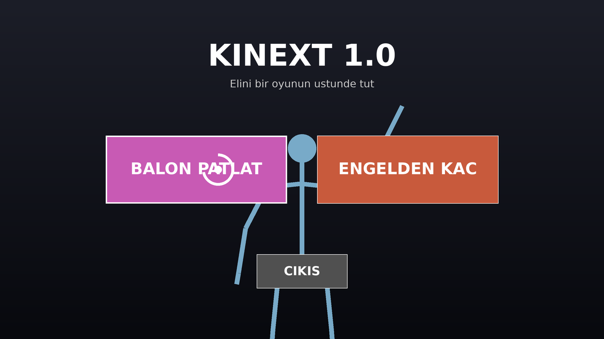
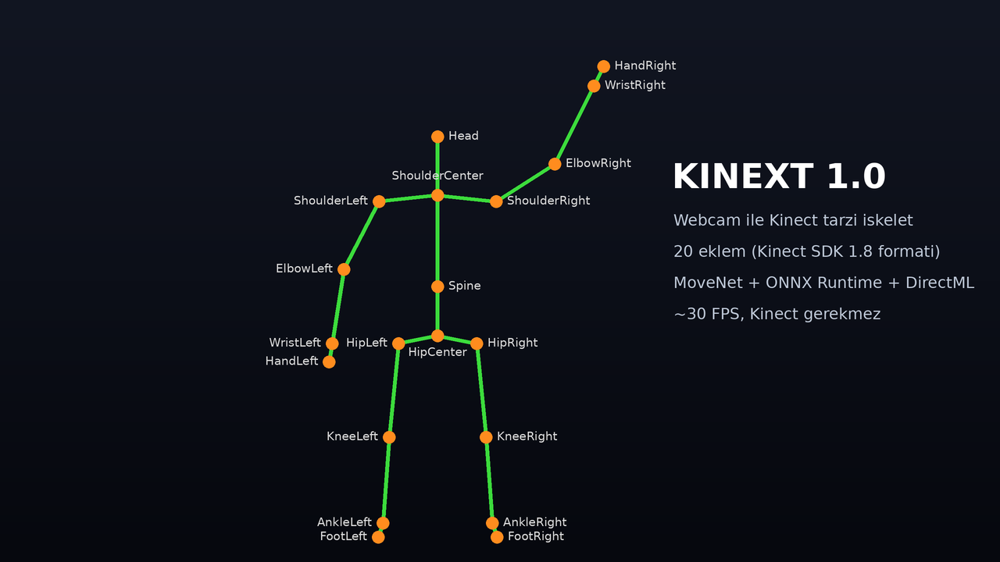

<p align="left">


</p>

Kinect olmadan, sıradan bir webcam ile Kinect tarzı hareket oyunları.
Hedef: PC (Windows/Linux), Baldic OS, native Xbox (UWP / Dev Mode) ve Raspberry Pi 5 tabanlı Kinext konsolu.

> Kinext, Microsoft ile bağlantılı değildir. "Kinect" ve "Xbox", Microsoft Corporation'ın ticari markalarıdır.

<p align="center">
  
  
  
  
</p>

<sub>Görseller temsilidir: oyunların görünümünü anlatmak için `docs/gen_images.py` ile koddan çizilmiştir, gerçek kamera görüntüsü içermez. Oyunda arka planda kamera görüntüsü karartılmış olarak görünür.</sub>

## Neler var

**Kinext Core** (`kinext_core`): Webcam görüntüsü → MoveNet poz modeli (ONNX Runtime, Windows'ta DirectML ile GPU) → **Kinect v1 formatında 20 eklemli iskelet** → jest algılama.

- Kinect SDK 1.8'deki eklem adları ve sırası (`HipCenter` … `FootRight`)
- Kişiye odaklı kırpma: model her karede oyuncunun bulunduğu bölgeye yakınlaşır, bacak ve ayak takibi çok daha iyi olur
- Titreme önleyici yumuşatma (hızlı hareketlerde gecikme yapmaz)
- Jestler: sol/sağ/iki el yukarı, sağa/sola eğilme, zıplama, sağ eli hızla savurma
- Kamera seçimi: Windows'taki kamera adlarıyla sağ üstte butonlar, `C` tuşu ile sıradaki kamera

**Programlar**

| Program | Ne yapar |
|---|---|
| `kinext_games.exe` | Kinect tarzı menü ve oyunlar. Seçim, elini butonun üstünde tutarak yapılır. |
| `kinext.exe` | İskelet test aracı: eklemleri ve algılanan jestleri gösterir, `J` ile JSON çıktısı verir. |

**Oyunlar**

- 🎈 **Balon Patlat**: aşağıdan yükselen balonları ellerinle patlat (60 saniye, zamanla hızlanır)
- 🧱 **Engelden Kaç**: 3 şeritte düşen bloklardan sağa-sola kayarak kaç (3 can)

## Gerekenler (Windows)

1. **Visual Studio 2022+**: "C++ ile masaüstü geliştirme" iş yükü; *C++ CMake araçları* ve *vcpkg paket yöneticisi* bileşenleri seçili olsun.
2. **ONNX Runtime (DirectML)**: nuget.org'dan **Microsoft.ML.OnnxRuntime.DirectML** paketini indir (`.nupkg` aslında bir zip dosyası).
   Uzantısını `.zip` yapıp içini `third_party/onnxruntime/` klasörüne çıkar.
3. **Model**: Hugging Face'teki `Xenova/movenet-singlepose-lightning` deposundan `onnx/model.onnx` dosyasını indir,
   `models/movenet_lightning.onnx` olarak kaydet.
   Daha isabetli takip için isteğe bağlı: `Xenova/movenet-singlepose-thunder` → `models/movenet_thunder.onnx` (varsa otomatik kullanılır).

OpenCV'yi elle kurmana gerek yok; `vcpkg.json` sayesinde Visual Studio ilk açılışta kendisi indirip derler (ilk sefer 15–40 dakika sürebilir).

## Derleme ve çalıştırma

1. Visual Studio → **Klasör aç** → bu klasörü seç
2. Yapılandırma olarak **Kinext - Windows x64** seçili olsun; CMake ve vcpkg işini bitirene kadar bekle
3. Başlangıç öğesi olarak **kinext_games.exe**'yi seç
4. **Ctrl+Shift+B** ile derle, ▶ ile çalıştır

Kamerayı TV'nin üstüne ya da göğüs-baş hizasına koy, 2–3 metre geride, tüm vücudun görünecek şekilde dur.

### Tuşlar

| Tuş | kinext_games | kinext |
|---|---|---|
| `ESC` | Oyundan menüye / menüden çıkış | Çıkış |
| `C` | Sıradaki kamera | Sıradaki kamera |
| `M` | | Aynalamayı aç/kapa |
| `J` | | İskeleti JSON olarak yazdır |

## Proje yapısı

```
src/
  skeleton.hpp      Kinect formatında iskelet + yumuşatma
  pose.hpp/.cpp     MoveNet ile poz tahmini (ONNX Runtime + DirectML), kişiye odaklı kırpma
  gestures.hpp      Jest algılama
  camera_list.hpp   Windows kamera adları (Media Foundation)
  camera.hpp        Kamera açma/değiştirme, isimli butonlar
  main.cpp          İskelet test aracı (kinext.exe)
  games_main.cpp    Menü ve oyun döngüsü (kinext_games.exe)
  games/
    game.hpp        Oyun arayüzü, el ile seçilen butonlar, çizim yardımcıları
    balloon.hpp     Balon Patlat
    dodge.hpp       Engelden Kaç
```

## Yol haritası

1. ✅ Webcam ile iskelet takibi + jestler
2. ✅ İlk küçük oyunlar (Balon Patlat, Engelden Kaç)
3. Daha fazla oyun (bowling, poz taklidi, kaleci…)
4. Gerçek Kinect desteği (SDK 1.8 / libfreenect)
5. Xbox One tarzı dashboard
6. Native Xbox sürümü (UWP, Dev Mode, MediaCapture + DirectML)
7. Oyun konsolu sürümü: Raspberry Pi 5 + webcam ile TV'ye takılan, kendi başına çalışan Kinext konsolu
