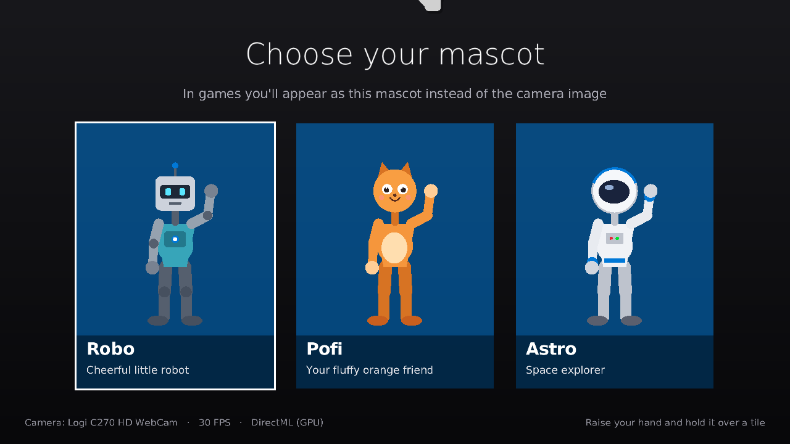
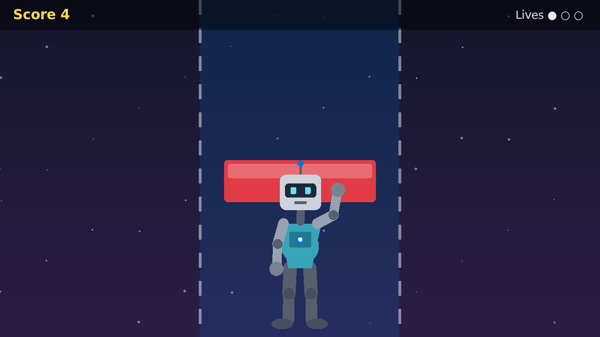
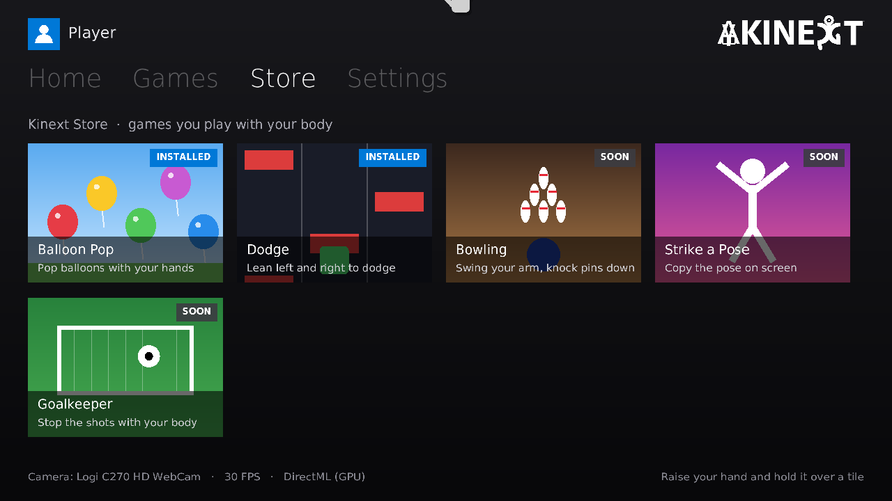
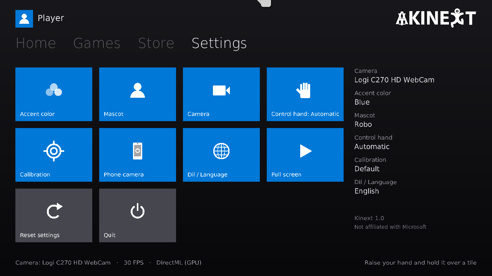

<p align="left">
  
</p>

Kinect-style motion games with an ordinary webcam, no Kinect required.
Targets: PC (Windows/Linux), Baldic OS, native Xbox (UWP / Dev Mode) and a Raspberry Pi 5 based Kinext console.

> Kinext is not affiliated with Microsoft. "Kinect" and "Xbox" are trademarks of Microsoft Corporation.

<p align="center">
  
  
  
  
  
  
</p>

<sub>Screenshots are taken from the program itself using simulated player data instead of a camera; they contain no real camera footage.</sub>

## Download

Get **Kinext-1.0-Setup.exe** from the [Releases](https://github.com/shast76/Project-Kinext/releases) page and run it.
The installer includes everything (models, libraries, Visual C++ runtime).

**Requirements:** Windows 10/11 64-bit, a webcam (or your phone's camera). A DirectX 12 capable GPU is recommended; without one, tracking runs on the CPU.

## Features

**Kinext Core** (`kinext_core`): webcam image → MoveNet pose model (ONNX Runtime, GPU via DirectML on Windows) → **20-joint skeleton in Kinect v1 format** → gesture detection.

- Joint names and order from Kinect SDK 1.8 (`HipCenter` … `FootRight`)
- Person-focused cropping: the model zooms in on the player every frame, giving much better leg and foot tracking
- One Euro filter smoothing: removes jitter without lag on fast movements
- Gestures: left/right/both hands up, lean left/right, jump, fast right-hand swipe

**Kinext Dashboard** (`kinext_dashboard.exe`, the main app): an Xbox One (2013–2015) style home screen.

- **Home · Games · Store · Settings** tabs, Metro tiles, selectable accent color
- **Hand control:** raise your hand, hold the translucent hand cursor over a tile until the ring fills (mouse works too)
- **Calibration:** tell Kinext how far you can comfortably reach, so the cursor covers the whole screen
- **Phone camera:** use your phone as the camera over Wi-Fi (IP Webcam etc.) or with a webcam app
- **Turkish and English** interface
- Control hand (auto / left / right), camera selection, full screen, settings reset
- **Mascots:** in games you appear as your chosen mascot instead of the camera image: **Robo**, **Pofi**, **Astro**
- Camera and pose tracking run on a background thread, so the UI stays smooth
- Rendering: [raylib](https://www.raylib.com/)

**Games**

- 🎈 **Balloon Pop**: pop the rising balloons with your hands (60 seconds, speeds up over time)
- 🧱 **Dodge**: lean left and right to dodge blocks falling in 3 lanes (3 lives)
- Coming soon in the Store: Bowling, Strike a Pose, Goalkeeper

**Other programs** (for development/testing)

| Program | What it does |
|---|---|
| `kinext.exe` | Skeleton test tool: shows joints and gestures over the camera image, `J` prints JSON. |
| `kinext_games.exe` | The first OpenCV game prototype (over the camera image). |

## Building from source (Windows)

### Requirements

1. **Visual Studio 2022+** with the "Desktop development with C++" workload; make sure *C++ CMake tools* and *vcpkg package manager* are selected.
2. **ONNX Runtime (DirectML)**: download the **Microsoft.ML.OnnxRuntime.DirectML** package from nuget.org (a `.nupkg` is just a zip file).
   Rename it to `.zip` and extract it into `third_party/onnxruntime/`.
3. **Model**: download `onnx/model.onnx` from the `Xenova/movenet-singlepose-lightning` repository on Hugging Face
   and save it as `models/movenet_lightning.onnx`.
   Optional, for more accurate tracking: `Xenova/movenet-singlepose-thunder` → `models/movenet_thunder.onnx` (used automatically if present).

You don't need to install OpenCV or raylib yourself: thanks to `vcpkg.json`, Visual Studio downloads and builds them on first open (the first time can take 15–40 minutes).

### Build and run

1. Visual Studio → **Open a local folder** → select this folder
2. Select the **Kinext - Windows x64** configuration and wait for CMake and vcpkg to finish
3. Choose **kinext_dashboard.exe** as the startup item
4. Build with **Ctrl+Shift+B**, run with ▶

Place the camera on top of the TV or at chest/head height, and stand 2–3 meters back so your whole body is visible.

### Building the installer

1. Install [Inno Setup](https://jrsoftware.org/isdl.php) 6 or 7
2. Build `kinext_dashboard.exe` in Release
3. Run `installer\build_installer.bat` → `installer\Output\Kinext-1.0-Setup.exe`

### Keys

| Key | kinext_dashboard | kinext |
|---|---|---|
| `ESC` | Quit game / back to home | Quit |
| `F11` | Full screen | |
| `C` | | Next camera |
| `M` | | Toggle mirroring |
| `J` | | Print skeleton as JSON |

Settings and high scores are stored in `%APPDATA%\Kinext\kinext_settings.txt`.

## Project structure

```
src/
  skeleton.hpp      Kinect-format skeleton + One Euro filter
  pose.hpp/.cpp     MoveNet pose estimation (ONNX Runtime + DirectML), person-focused crop
  gestures.hpp      Gesture detection
  camera_list.*     Windows camera names (Media Foundation)
  camera.hpp        Opening/switching cameras
  mjpeg.*           Phone camera over Wi-Fi (MJPEG stream)
  tracker.*         Runs camera + pose tracking in the background
  dash/             Dashboard (raylib)
    dashboard_main.cpp  Scenes: first-run setup, tabs, calibration, phone, games
    ui.hpp          Theme, fonts, hand cursor and selection system
    lang.hpp        Turkish / English texts
    avatar.hpp      Mascots (Robo, Pofi, Astro)
    games.hpp       Game framework, store catalog, covers
    game_balloon.hpp, game_dodge.hpp
    settings.hpp    Settings and high scores
  main.cpp          Skeleton test tool (kinext.exe)
  games_main.cpp, games/   First OpenCV games (kinext_games.exe)
installer/          Inno Setup script and wizard images
assets/             Logo and app icon
```

## Roadmap

1. ✅ Webcam skeleton tracking + gestures
2. ✅ First small games (Balloon Pop, Dodge)
3. ✅ Xbox One style dashboard, store and mascots
4. ✅ Calibration, phone camera, Turkish/English, installer
5. More games (bowling, pose matching, goalkeeper…)
6. Real Kinect support (SDK 1.8 / libfreenect)
7. Native Xbox version (UWP, Dev Mode, MediaCapture + DirectML)
8. Game console version: a standalone Kinext console with a Raspberry Pi 5 + webcam that plugs into your TV
