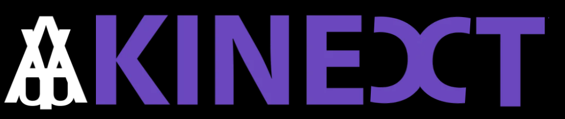
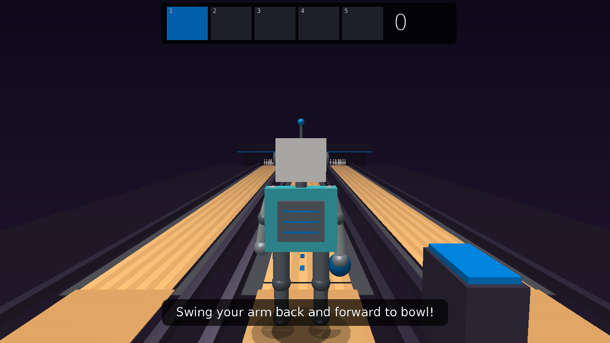
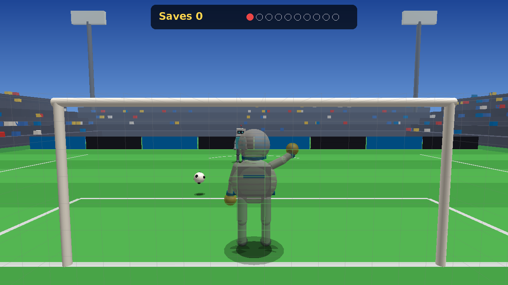
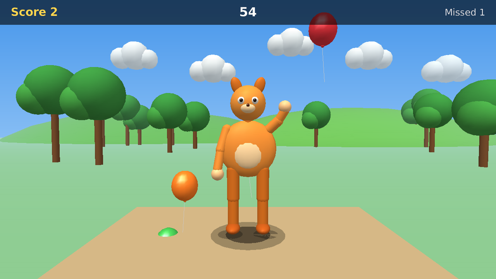
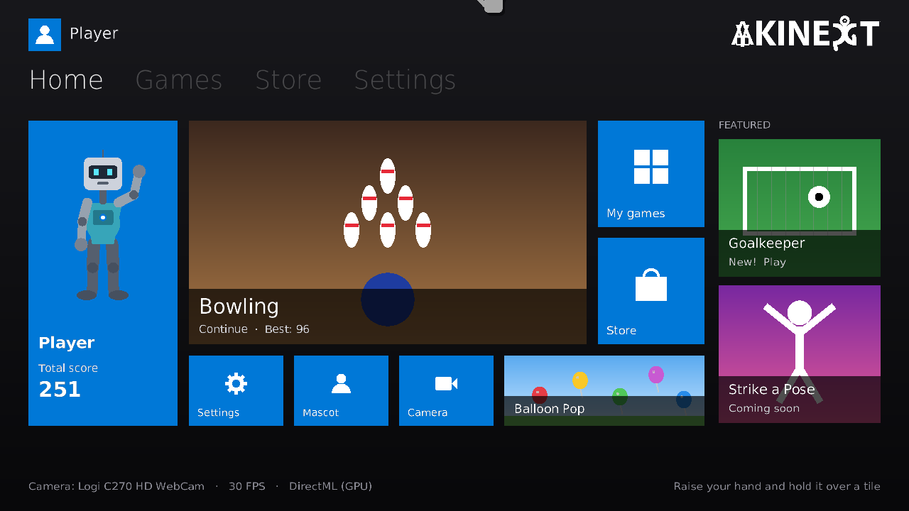
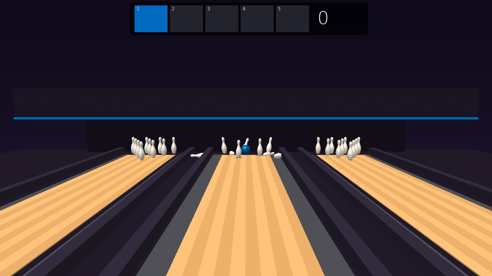
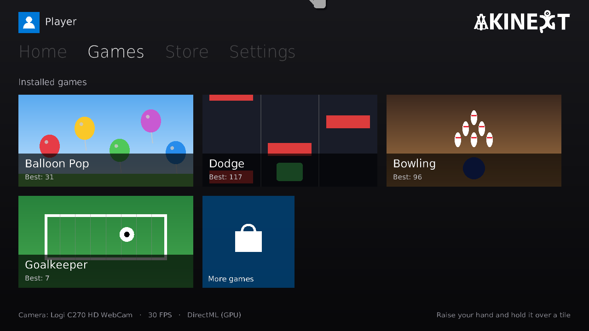

<p align="left">
  
</p>

**Kinect Sports-style motion games with an ordinary webcam. No Kinect required.**

Kinext tracks your whole body with a webcam (or your phone's camera), turns it into a Kinect-style skeleton and lets you play 3D motion games as a mascot. It runs on PC today; native Xbox and a Raspberry Pi 5 console are on the roadmap.

> Kinext is not affiliated with Microsoft. "Kinect" and "Xbox" are trademarks of Microsoft Corporation.

<p align="center">
  
  
  
  
  
  
</p>

<sub>Screenshots are taken from the program itself using simulated player data instead of a camera; they contain no real camera footage.</sub>

## Download

Get **Kinext-1.1-Setup.exe** from the [Releases](https://github.com/shast76/Project-Kinext/releases) page and run it.
The installer includes everything: the pose model, all libraries and the Visual C++ runtime.
Updating from 1.0 keeps your settings and high scores.

**Requirements:** Windows 10/11 64-bit · a webcam or your phone's camera · a DirectX 12 GPU is recommended (tracking falls back to the CPU without one)

Place the camera on top of the TV or at chest height and stand 2–3 m back so your whole body is visible. Raise your hand to get the cursor.

## What's new in 1.1

- **Real 3D games** with lighting, shadows and 3D mascots, in the style of Kinect Sports
- **New Bowling** with real lane dimensions, pin physics and real scoring
- **Goalkeeper**, a new game in a 3D stadium
- **Create your own character** from 8 PNG parts
- **Voice commands** that work offline
- Balloon Pop and Dodge rebuilt in 3D

## Games

| | |
|---|---|
| 🎳 **Bowling** | Choose your bowling hand, reach out to the side to pick up the ball, step left or right to aim, then swing your arm back and forward to bowl. Swing speed sets the ball speed, and moving your hand sideways adds angle and hook. Features a real 18.3 m lane, colliding pins and real 10-pin scoring (strike and spare bonuses, extra rolls in the last frame) over 5 frames. The camera follows the ball down the lane. |
| 🧤 **Goalkeeper** | You stand in goal while a striker runs up and shoots 10 times. Save with your hands, feet, head or body. Shots get faster and go for the corners more often. You are drawn semi-transparent so you can always see the ball. |
| 🎈 **Balloon Pop** | Pop as many balloons as you can in 60 seconds in a sunny park. The camera faces you like a mirror. |
| 🧱 **Dodge** | Lean left and right to dodge blocks rushing at you on a neon night road. You have 3 lives. |

<p align="center">
  
  
</p>

## Features

- **Xbox One (2013–2015) style dashboard** with Home, Games, Store and Settings tabs, Metro tiles and a selectable accent color
- **Hand control:** raise your hand and hold the translucent hand cursor over a tile until the ring fills. The mouse works too.
- **Calibration:** tell Kinext how far you can comfortably reach so the cursor covers the whole screen
- **Mascots:** in games you appear as **Robo**, **Pofi**, **Astro** or your own character, never as the camera image
- **Phone camera:** use your phone as the camera over Wi-Fi (e.g. the IP Webcam app)
- **Voice commands** (Windows speech recognition, fully offline, audio is never recorded or sent anywhere)
- **Turkish and English** interface
- **Control hand** setting (automatic / left / right), camera selection, full screen and settings reset

### Voice commands

Turn them on in **Settings → Voice**, then say:

`Kinext, play bowling` · `Kinext, play goalkeeper` · `Kinext, play balloon pop` · `Kinext, play dodge` · `Kinext, home` · `Kinext, games` · `Kinext, store` · `Kinext, settings` · `Kinext, back` · `Kinext, play again` · `Kinext, full screen` · `Kinext, calibrate`

Commands are in English. If a Turkish speech recognizer is installed, Turkish commands such as `Kinext, bowling oyna` work too. If nothing is heard, check *Windows Settings → Privacy → Microphone* and *Time & language → Speech*.

## Create your own character


1. In the mascot screen, select **Your own character**. This opens the template folder.
2. Copy the folder and draw over the 8 PNG parts: `head`, `torso`, `upper_arm`, `lower_arm`, `hand`, `upper_leg`, `lower_leg` and `foot`. Keep the background transparent. The red dashed lines mark the joints, at 10% from the top and 10% from the bottom of each image.
3. Write the name and description in `character.txt`.
4. **Drag and drop the folder onto the Kinext window.** Your character is added to the mascot list and plays in every game.

Notes on the parts:

- Arm and leg images are for the right side; the left side is mirrored automatically. Add `_left` files (for example `upper_arm_left.png`) if you want a different left side.
- Optionally add `head_back.png` and `torso_back.png`, which are used when a 3D game shows you from behind.
- The example character **Kiki** is included. The template's `OKU_BENI.txt` explains everything in Turkish and English.

<br clear="right">

## How it works

**Kinext Core** (`kinext_core`) takes the webcam image and runs the MoveNet pose model on it (ONNX Runtime, with GPU acceleration through DirectML on Windows). The result is converted into a **20-joint skeleton in Kinect v1 format**, which drives gesture detection.

- Joint names and order follow Kinect SDK 1.8 (`HipCenter` … `FootRight`)
- Person-focused cropping makes the model zoom in on the player every frame, giving much better leg and foot tracking
- A One Euro filter removes jitter without adding lag to fast movements
- Camera and pose tracking run on a background thread

**3D:** the games use a small 3D layer on top of [raylib](https://www.raylib.com/). Lighting is computed per vertex on the CPU, so the games look the same on every GPU and no shader support is needed. A webcam cannot measure depth, so the 2D skeleton is placed on a vertical plane in the 3D world, and touch checks are more forgiving in depth.

<p align="center"></p>

## Building from source (Windows)

### Requirements

1. **Visual Studio 2022+** with the "Desktop development with C++" workload. Make sure *C++ CMake tools* and *vcpkg package manager* are selected.
2. **ONNX Runtime (DirectML)**: download the **Microsoft.ML.OnnxRuntime.DirectML** package from nuget.org. A `.nupkg` is just a zip file: rename it to `.zip` and extract it into `third_party/onnxruntime/`.
3. **Model**: download `onnx/model.onnx` from the `Xenova/movenet-singlepose-lightning` repository on Hugging Face and save it as `models/movenet_lightning.onnx`.
   Optional, for more accurate tracking: `Xenova/movenet-singlepose-thunder` → `models/movenet_thunder.onnx`. It is used automatically if present.

You don't need to install OpenCV or raylib yourself. Thanks to `vcpkg.json`, Visual Studio downloads and builds them the first time you open the project, which can take 15–40 minutes.

### Build and run

1. Visual Studio → **Open a local folder** → select this folder
2. Select the **Kinext - Windows x64** configuration and wait for CMake and vcpkg to finish
3. Choose **kinext_dashboard.exe** as the startup item
4. Build with **Ctrl+Shift+B**, run with ▶

### Building the installer

1. Install [Inno Setup](https://jrsoftware.org/isdl.php) 6 or 7
2. Build `kinext_dashboard.exe` in Release
3. Run `installer\build_installer.bat`. The result is `installer\Output\Kinext-1.1-Setup.exe`.

### Keys

| Key | Action |
|---|---|
| `ESC` | Leave a game / go back |
| `F11` | Full screen |
| `Space` | Bowling: pick up and throw the ball (for testing) |
| `L` / `R` | Bowling: choose left / right hand |

Settings, high scores and your characters are stored in `%APPDATA%\Kinext\`.

## Project structure

```
src/
  skeleton.hpp      Kinect-format skeleton + One Euro filter
  pose.hpp/.cpp     MoveNet pose estimation (ONNX Runtime + DirectML), person-focused crop
  tracker.*         Runs camera + pose tracking in the background
  camera*.*, mjpeg.*  Cameras and the phone camera (MJPEG over Wi-Fi)
  voice.*           Voice commands (Windows SAPI, offline)
  dash/             Dashboard and games (raylib)
    dashboard_main.cpp  Scenes: first-run setup, tabs, calibration, phone, games
    r3d.hpp         Small 3D layer: CPU lighting, shapes, shadows
    avatar.hpp      2D mascots, avatar3d.hpp: 3D mascots
    characters.hpp  Custom PNG characters (loading, drag and drop, drawing)
    game_*.hpp      Bowling, Goalkeeper, Balloon Pop, Dodge
    ui.hpp, lang.hpp, settings.hpp  Theme, hand cursor, Turkish/English, settings
assets/             Logo, icon, character template, example character
installer/          Inno Setup script and wizard images
tools/              Generator for the character template
```

## Roadmap

1. ✅ Webcam skeleton tracking + gestures
2. ✅ Xbox One style dashboard, store and mascots
3. ✅ Calibration, phone camera, Turkish/English, installer (1.0)
4. ✅ 3D games, new Bowling, Goalkeeper, custom characters, voice commands (1.1)
5. More games (Strike a Pose, table tennis, boxing…) and two-player mode
6. Real Kinect support (SDK 1.8 / libfreenect)
7. Native Xbox version (UWP, Dev Mode, MediaCapture + DirectML)
8. Game console version: a standalone Kinext console with a Raspberry Pi 5 + webcam that plugs into your TV
